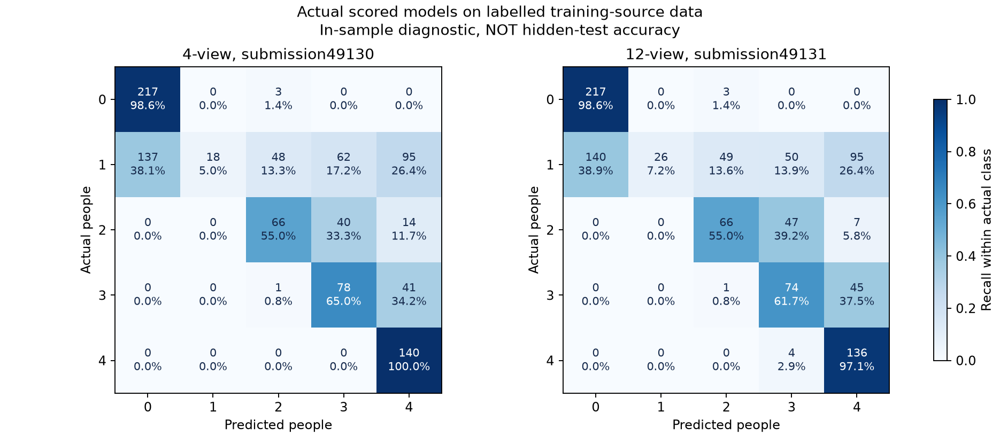

# 实际0.47模型：本地错误审计

## 数据与性质

运行的是原始提交文件49130（四视角）和49131（十二视角），并加入实际0.44文件对照，没有用重新训练代理替代。四视角及0.44逐窗使用未经修改的ONNX文件进行CPU推理。十二视角的原图在小版最终预测0/2时直接返回小版输出，因此对间隔大于0.005的这类窗口，在每条记录先用原文件核对该分支后复用数学上相同的输出，其余窗口直接跑原大版文件。大版实际ONNX调用575窗，保护分支复用385窗；逐窗执行方式有单独字段，不把复用计为真实大版调用。原模型哈希核对通过，没有训练、拟合新偏置或修改模型。

覆盖全部48条有标签记录，每条12000帧切为20个不重叠600帧窗口，共960窗。每窗ATI最后置0，与既有提交接口一致。原始CSI和ATI文件哈希已保存，输入检查通过。这些原记录参与过基础权重训练，**全部结果是训练来源数据上的诊断，不能当作验证或老师隐藏测试准确率。** 每条记录内窗口相关，不是960个独立场景。

## 总体与逐人数

- 原0.44：677/960，70.52%。
- 四视角0.47：519/960，54.06%。
- 十二视角0.47：519/960，54.06%。

这里的本地数字不改变平台登记的0.44/0.47/0.47。

| 真值 | 窗口数 | 四视角召回 | 十二视角召回 |
|---|---:|---:|---:|
| 0人 | 220 | 98.64% | 98.64% |
| 1人 | 360 | 5.00% | 7.22% |
| 2人 | 120 | 55.00% | 55.00% |
| 3人 | 120 | 65.00% | 61.67% |
| 4人 | 140 | 100.00% | 97.14% |

主要混淆：

- light047: 真实1人→预测0人：137窗；真实1人→预测4人：95窗；真实1人→预测3人：62窗；真实1人→预测2人：48窗；真实3人→预测4人：41窗
- full047: 真实1人→预测0人：140窗；真实1人→预测4人：95窗；真实1人→预测3人：50窗；真实1人→预测2人：49窗；真实2人→预测3人：47窗

## 逐房间与记录

| 房间 | 窗口数 | 四视角本地正确率 | 十二视角本地正确率 |
|---|---:|---:|---:|
| a1 | 240 | 74.17% | 63.33% |
| b1 | 20 | 100.00% | 100.00% |
| c1 | 240 | 57.08% | 65.00% |
| e1 | 60 | 66.67% | 65.00% |
| g1 | 340 | 40.59% | 40.88% |
| unknown | 60 | 10.00% | 21.67% |

房间人数分布不同，不能仅凭房间总体准确率评判房间难度。unknown保留原元数据，不猜测其真实房间。按四视角错误数优先排序的记录如下，完整48条见record_summary.csv：

| 原记录 | 真实人数 | 四视角正确窗 | 十二视角正确窗 |
|---|---:|---:|---:|
| a_a1_hash221231_1 | 1 | 0/20 | 0/20 |
| a_a1_hash813694_1 | 1 | 0/20 | 0/20 |
| c_c1_hash347235_1 | 1 | 0/20 | 0/20 |
| g_g1_hash084491_1 | 1 | 0/20 | 0/20 |
| g_g1_hash145095_1 | 1 | 0/20 | 0/20 |
| g_g1_hash160227_1 | 1 | 0/20 | 0/20 |
| g_g1_hash224345_1 | 1 | 0/20 | 0/20 |
| g_g1_hash245884_1 | 1 | 0/20 | 0/20 |

## 增强的收益、损失与互补

原0.44→四视角：纠正5窗，改错163窗。四视角→十二视角：纠正32窗，改错32窗，共89窗预测不同，两者共同错误409窗。

四视角最终预测0/2的窗口为472个，其中错误189个；十二视角在这些受外层保护窗口上出现0次类别不同。该统计不能直接代表小版内层保护是否触发。

固定等权概率融合的本地正确数为531/960。若借助真实标签总挑两版中正确的一版，理论并集为551/960；这个并集需要答案，不是可部署模型。这里只诊断互补性，没有用这些训练数据选择新提交。

## 固定偏置的本地作用

仅从实际0.44输出减去其最后五维固定偏置，得到去偏置诊断（不是重新运行原0.37文件，也没有重算0.47的保护门）。该诊断本地正确729/960。

| 真值 | 实际0.44召回 | 0.44末尾去偏置诊断召回 |
|---|---:|---:|
| 0人 | 97.73% | 71.82% |
| 1人 | 43.06% | 79.72% |
| 2人 | 55.83% | 34.17% |
| 3人 | 83.33% | 85.83% |
| 4人 | 100.00% | 100.00% |

这能帮助区分基础信号表示与最终分数偏移，但不能据此推荐删除偏置：偏置已在平台产生过收益，训练来源分布和隐藏分布不同。本地校准更好不等于隐藏更好。

## 一个窄范围保护的探索性诊断

观察到原0.44正确而增强改错后，固定检查一个规则：仅当原视角0.44的1人softmax分数至少0.8时保留其1人判断，其他全部沿用四视角0.47。不扫阈值。它触发0窗，纠正0窗、改错0窗，本地正确519/960。

这是看过训练来源错误后的探索，**不是独立验证，也没有导出提交文件**。0.8分数不等于80%真实可信度。若后续测试该方向，应把原0.47保持为对照，并明确它可能覆盖原0/2保护、可能在隐藏集引入新的错误，不能把本地收益换算为平台涨幅。

另一个固定消融是不设分数阈值、只保留原视角argmax为1的判断：触发158窗，纠正137窗、改错2窗，本地正确654/960。它同样是事后探索，并可能覆盖原0/2保护，不是已验证的升级。没有继续扫描阈值选最优点。

## 如何据此改进

四视角1人错误为342窗，占其441个错误的77.55%。这使下一轮优先级改变：先检验原始/变换视角冲突的处理，再扩大结构。原视角0.44在本地预测1人的精确率为155/158=98.10%，但召回仅43.06%，所以单独保留这些判断也救不回全部1人错误。

建议先做两个独立实验：

1. **冻结权重的原视角保护消融。** 把“原视角1人判断是否保留”作为一个小改动，与原0.47对照；这是探索候选，不能凭当前训练数据直接宣布平台会提升。0.8阈值没有触发样本，说明不能凭直觉设置信心阈值。
2. **带真实标签的变换一致性微调。** 从已有权重出发，训练时同时看原输入、时间反转及少量接收变换；保留原视角人数损失和表示约束，再对变换后的相同人数监督。分别比较只微调读出、残差适配器、适配器加一致性，避免继续只在推理时使用模型未充分适应的视角。标签监督优先，不能强迫学生复制教师在1人样本上的错误。

在这两个实验稳定后，再考虑0/1精细区分与2/3/4细分的结构变化。不能将新分支直接命名为静止、慢走、快走检测器，因为没有这些标签。先用实际模型错误指导消融，而非以代理3/4人失败为由扩大网络。

- 先检查下表最差原始记录是否有异常采集、时间间隔或标签来源问题。模型预测不能证明标签错，不能自动改标签。
- 把真实0.47在本地的错误类型与留房间代理分开：若原权重已能识别本地3/4人，而代理失败，后续重点应是跨房间保留该表示，而非声称实际0.47没有学会3/4人。
- 区分原0.44已错、多视角纠正、以及增强改错三组记录。对共同错误优先检查信号表示/校准；对增强改错优先检查视角可靠性。训练数据上的哪个方案更准，不足以决定隐藏平台选哪个。
- 若只少量记录贡献大量错误，先做记录级稳健性和采集差异诊断，不通过重叠窗口把同一条错误记录重复成大量独立证据。
- 所有后续训练/校准都保留记录与房间隔离；不得用实际全数据0.47作为外层留房间教师后把该验证称为独立。

本报告定位的是已知数据上的实际错误。老师隐藏集哪些类错、各类比例及具体房间仍不可见，不能把这些错误比例直接当作隐藏集分布，也不能承诺修正这些记录就达到0.54。

## 文件

实验目录：`D:/huawei2026-experiments/actual047_audit_20261024`。

- errors.csv：任一0.47预测错误的窗口，含原记录、帧范围、真实人数、两版预测及分数。
- all_predictions.csv：960窗完整输出，含0.44对照。
- record_summary.csv：48条记录的正确数及预测分布。
- summary.json：总体、逐类、逐房间、纠正/改错及哈希。
- records/：逐原记录检查点，可从中断处继续。

errors.csv中的softmax最大值只是输出分数，不是经独立验证的正确概率。relative_frame_change只是原始幅度相邻变化指标，不是真实运动速度或静止/慢走/快走标签。
