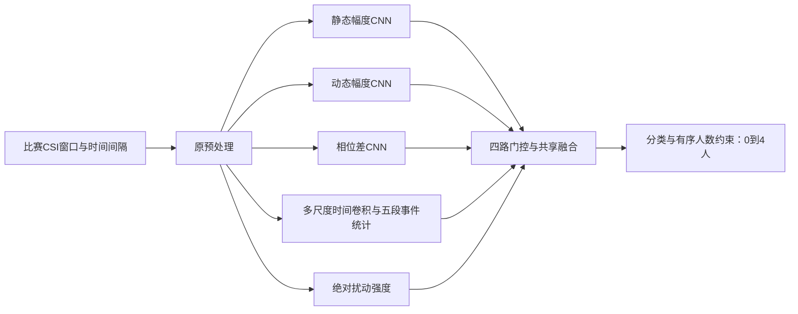

# 历史平台最佳0.38：多尺度局部事件模型

后续跨注意力版已获0.39，当前最佳与经验总结见[MODEL_039.md](MODEL_039.md)。下文保留0.38反馈时的事实与分析。

用户反馈平台0.38；比历史0.37高1个百分点，提交编号未知。该反馈属于这一份确定文件，不赋给其他种子、门控修订或时延关系模型。

- 最佳命名副本：models/best_038/model.onnx。
- 原正式文件：models/structure_events_20261021/01_events_seed42.onnx。
- 原提交副本：submissions/structure_events_20261021/model.onnx。
- 三者SHA256均为6d3799c7179b01f0cb9c36194aa8f60d6709b4851db82290bdb60db1143a06e3；69,362,182字节、17,396,552个参数。

## 结构

原0.37模型的前三条空间路线保留：静态幅度CNN、动态幅度CNN、天线间相位差CNN。每条使用四层残差卷积（64/128/256/384通道）并输出256维证据。静态幅度可包含房间/人体的综合响应，动态幅度捕捉随时间变化，相位差补充多径扰动信息；这些路线没有逐人或动作真值监督，不能说某条直接检测静止的人。

第四条路线由原时间Transformer换成EventEncoder：动态幅度先从128频组聚合为32频组，与6路相位差一起形成288个信号通道，再加3个实测时间通道，共291通道。投影128通道后，并行长度3/9/21的深度卷积加点卷积，得到384通道时间特征。长度代表时点数，断包情况下不保证精确固定秒数。

随后学习32种sigmoid软事件响应，将150时点分成五段、每段30点；每段统计响应均值、标准差、峰值、相邻变化率，并与整段卷积特征的均值/标准差/峰值一起投影为256维。设计意图是同时保留短暂扰动、较持久变化和它们在窗口中的分布，避免只做整段平均丢失局部线索。32个事件是隐特征，不是32个人，也不是静/慢/快三个人工标签。

四路证据继续通过原门控专家和共享融合网络预测0—4人。绝对扰动强度作为补充输入；分类、有序人数阈值和有人/无人输出保留。最终0.38模型没有启用时延关系矩阵分支，也没有保留原时间Transformer的门控事件修订；这些是失败对照，不能混称为最终结构。

## 实际训练

仅使用比赛提供的48条有标签记录，形成960个不重叠窗口的训练池。没有EHUNAM、Brescia、RadioPoints或SHARP数据，没有外部预训练，没有150条U数据，也没有把全量0.37权重用作初始化。从随机seed42开始训练。

AdamW，学习率0.0004、weight decay0.01，batch32、5轮，梯度裁剪3；沿用原类别/房间平衡抽样和原损失，不以验证最高轮数挑检查点。五轮合计4800次窗口抽样，覆盖全部48记录和823个不同窗口；有放回平衡抽样不保证遍历960窗的每一窗。

损失保持原配方：主分类损失 +0.15×路线专家分类 +0.5×有序人数阈值损失 +0.1×两输出一致性 +0.1×信号相关统计回归。这里的一致性在有标签样本的两个人数输出之间；辅助统计来自信号本身，不是外部动作标签，不是U伪标签训练。

开发时a1/c1/g1整房间留出、两种子比较；最终提交文件用全部48条重新训练，不留出这些房间。实际训练、配置、抽样覆盖与导出检查在D:/huawei2026-experiments/structure_events_20261021。

## 经验和下一步

本地两种子三房间均值：新结构28.9%，原版27.0%。但e1压力测试新结构0%，本地4人召回几乎为零。这些失败仍成立，不会因为平台0.38而删除。平台比0.37高1个百分点是新证据，说明原本根据e1失败作出的保守推荐没有完整预测平台排序；不能把本地某一个房间的失败或均值当作绝对淘汰标准。

这版已经是纯比赛有标签数据训练，因此“删去外部数据再训一遍”并不是新方案。后续应以该文件为新结构基线，先分别比较训练轮数/学习率计划、采样策略和多个随机初始化；保持同样验证记录、记录逐类误差，不同时改变所有因素。比赛150条无标签数据可另作独立研究，不能直接当有标签样本。一次1个百分点提升不能说明某个结构细节必然有效，需要后续对照。

若未来再考察外部数据，应对同一事件结构做“纯比赛/加外部”的配对实验；目前0.34/0.35来自不同迁移方案，不能直接归因于外部数据本身。

核验：checks/events_038_feedback.json。只更新成绩/推荐和新命名副本，本次没有重新训练；两份旧0.37模型哈希均保持不变。训练完成时的原报告见STRUCTURE_EVENTS_20261021.md，其顶部已追加本次后续平台反馈。
